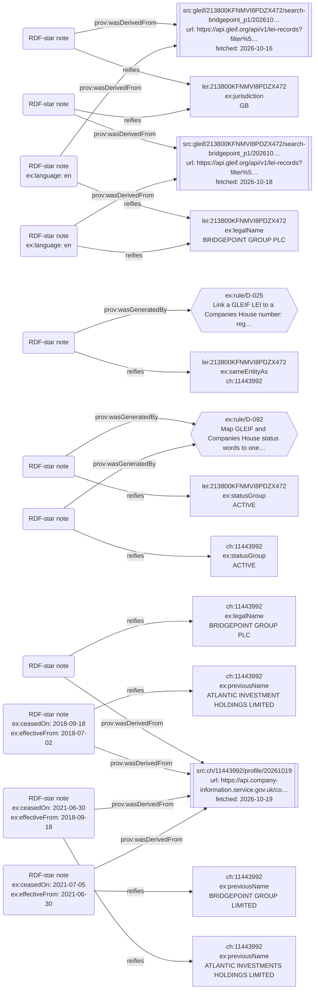
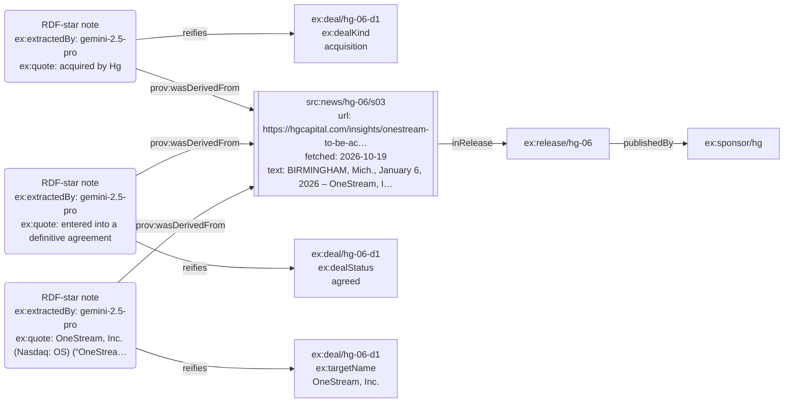

# Fact to source, drawn from the RDF graph (generated by `uv run python -m seisa_kg.rdf.provenance_view`)

The second visualisation (the first is Neo4j Bloom: `docs/images/`). Every box below is read from `data/output/graph.ttl` by SPARQL.
Read each arrow from the RDF-star note: the note **reifies** (points at) the fact, and says where the fact came from: **wasDerivedFrom** a source record (with its web address and fetch time), or **wasGeneratedBy** one of our rules (D-029).

## 1. A registry company: Bridgepoint Group plc (GLEIF and Companies House)

The same name is stated by GLEIF on two fetch dates, so that one fact has two notes (D-042). The status group and the GLEIF–Companies House link are our own judgements, so their notes point to a rule. A previous name carries its dates on its note.

## 2. A news fact: Hg's OneStream deal

Each fact's note carries the exact quote and the model that extracted it; the note points to the sentence, the sentence to its release, and the release to the sponsor that published it.

